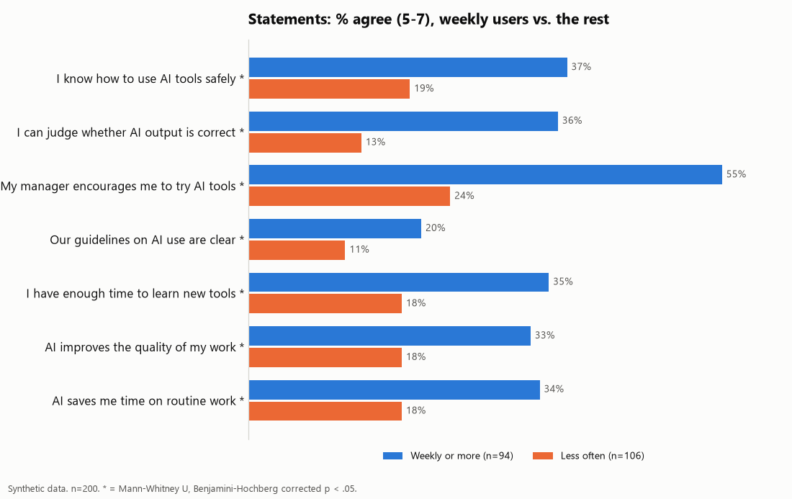
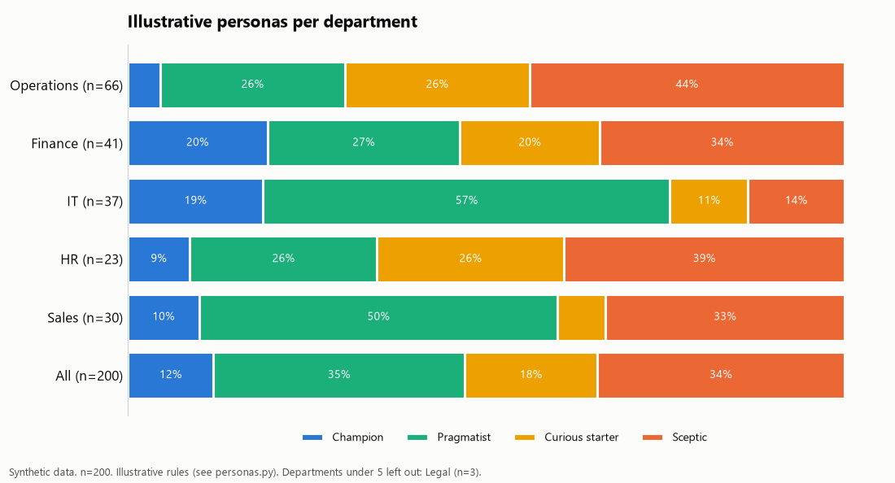
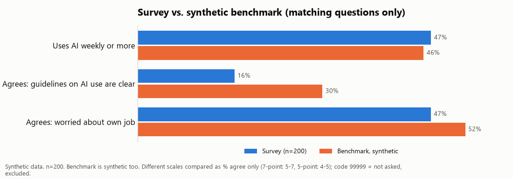

# Survey analysis pipeline

A survey export goes in. Key figures, crosstabs, significance tests, a persona split, charts (PNG), an Excel file with every table and a PowerPoint deck with one chart per slide come out. One command, about 5 seconds.

**All data in this repository is synthetic.** The survey ("AI adoption at work" at a fictional organisation), the respondents, the open answers and the benchmark are generated by `make_synthetic_data.py` with a fixed seed. No real organisation, person or result is in here.

## Problem

An employee survey usually ends in a spreadsheet and a deck that someone builds by hand. That is slow, hard to check and has to be redone when late responses come in. It is also easy to get the method wrong in ways nobody notices: percentages over the wrong base when a question was only shown to some people, small groups that make individuals recognisable, or comparisons with an external benchmark that asked a different question on a different scale.

## What I built

A small Python pipeline that reads a Qualtrics-style CSV/XLSX export and produces every table and chart from code, so a new export means one rerun. I built the original for a real client survey; this is a rebuild on invented questions and synthetic data, with the same structure and the same methodological rules.

```
 survey export (CSV/XLSX, 3 header rows)
        |
        v
 read_export.py    map columns by question text, drop IP/location columns,
                   parse scales, multi-select, routing, "not asked" codes
        |
        v
 one record per respondent  ---->  personas.py (illustrative rules)
        |
        v
 analysis.py       key figures, counts per question, statements, crosstabs,
 stats_tests.py    chi-square, Mann-Whitney U, Benjamini-Hochberg
 benchmark.py      comparison on matching questions only (synthetic benchmark)
        |
        +--> charts.py   -> output/charts/*.png
        +--> slides.py   -> output/deck.pptx   (title slide + one chart per slide)
        +--> output/tables.xlsx, summary.md, open_answers.md, mapping.md
```

| File | Role |
| --- | --- |
| `config.py` | Answer options, statements, scale labels, minimum group size, colours, paths |
| `make_synthetic_data.py` | Generates the fake export (200 completed + 10 incomplete, seed 42) and a fake benchmark (n=600) |
| `read_export.py` | Reads the export and turns each row into one record |
| `personas.py` | Four illustrative personas from usage frequency and attitude |
| `analysis.py` | Tables, crosstabs, per-group figures and the tests |
| `stats_tests.py` | Chi-square, Mann-Whitney U and Benjamini-Hochberg in numpy only (no SciPy) |
| `benchmark.py` | Comparison with a reference group on matching questions only |
| `charts.py`, `slides.py` | PNG charts (matplotlib) and the deck (python-pptx) |
| `run_pipeline.py` | Runs everything in order |
| `tests/test_pipeline.py` | 29 tests |

## Methodological choices

- **Routing.** Follow-up questions (tasks, level of use, minutes saved) are only asked to people who use AI monthly or more. Their percentages use that group as the base, every chart says "users only" and shows the n, and an answer a non-user still filled in is ignored.
- **Minimum group size 5.** A department or persona with fewer than 5 respondents is not shown separately, in tables, crosstabs or charts. The summary lists what was left out (in the example: `Legal (n=3)`).
- **Compare only matching questions.** The benchmark asked some things differently. Where only the scale differs (5-point vs. 7-point), only the share that agrees is compared (4-5 vs. 5-7). Where the question type differs (yes/no vs. a statement), it is not compared at all, and the summary says so.
- **Special codes for "not asked".** `-99` (seen, not answered) and `99999` (not asked) count as missing everywhere, so they never pull an average down.
- **Mapping by question text, not column code.** Column codes shift when someone edits the survey. Each field is matched on a piece of its question text, the result is written to `mapping.md` with warnings, and `data/mapping.json` can override a match.
- **Privacy at the door.** IP address, location and recipient name/e-mail columns are dropped when the file is read. Open answers are written without department.
- **Fail loudly on a broken export.** A CSV that was opened and saved in Excel (all fields merged into one column) is refused. Unknown scale labels and unknown multiple-choice options are reported, not silently dropped.
- **Significance with correction.** Department x weekly use: chi-square with Cramer's V and the share of cells with expected count below 5. Each statement, weekly users vs. the rest: Mann-Whitney U (normal approximation with tie and continuity correction) with rank-biserial r, and Benjamini-Hochberg over the seven statements.
- **Illustrative personas.** Two axes, my own simple rules, not a validated model: weekly use or not, and attitude (mean of the two "Value" statements, minus half a point per point of job worry above neutral). Champion, Pragmatist, Curious starter, Sceptic. See `personas.py`.

## Example output (synthetic run)

The files in [`examples/`](examples/) come from `python make_synthetic_data.py && python run_pipeline.py`: all seven charts, the deck ([`examples/deck.pptx`](examples/deck.pptx)) and the summary ([`examples/summary.md`](examples/summary.md)).







From the same run (numbers describe the fake data, nothing else):

| Result | Value |
| --- | --- |
| Respondents | 200 completed of 210 started |
| Uses AI weekly or more | 47% |
| Department x weekly use | chi2 = 23.0, df = 4, p < 0.001, Cramer's V = 0.34 (Legal, n=3, left out) |
| Statements, weekly users vs. the rest | all 7 significant after Benjamini-Hochberg (r between 0.23 and 0.39) |

The effects are there because the generator builds them in (frequent users are given a more positive attitude). The point is that the pipeline finds and reports them correctly.

## How to run

Python 3.10 or newer.

```bash
pip install -r requirements.txt
python make_synthetic_data.py      # writes data/survey_export_synthetic.csv and data/benchmark_synthetic.csv
python run_pipeline.py             # writes everything to output/
python -m pytest -q                # tests
```

Options: `python run_pipeline.py path/to/export.csv` for a specific file, `--include-incomplete` to keep unfinished responses, `python make_synthetic_data.py --n 500 --seed 7` for a different fake sample.

To use it on a real export, change the questions and options in `config.py` and the question-text fragments in `VELDEN` in `read_export.py`, run once and check `output/mapping.md`. `data/` and `output/` are in `.gitignore` so an export does not end up in git by accident.

## Tests

Measured on 2026-11-11, Python 3.12.10 on Windows 11 (pandas 3.0.6, numpy 2.5.3, matplotlib 3.11.2, python-pptx 1.0.2):

```
$ python -m pytest -q
29 passed in 4.54s
```

They cover the parts that can go wrong without an error message:

- chi-square tail probabilities against table values (e.g. 3.841 at df=1 gives 0.05), a 2x2 table worked out by hand, Mann-Whitney U and z against a hand calculation, Benjamini-Hochberg
- persona boundaries (monthly use is not weekly; missing attitude gives no persona)
- reading: "Other, please specify" with a comma inside, unknown options and labels, `-99` and `99999`, dropped privacy columns, duplicate column codes, refusing an Excel-mangled CSV
- routing: a non-user's follow-up answers are ignored
- anonymity: a group of 4 disappears from per-group tables and crosstabs
- benchmark: `99999` excluded, 5-point vs. 7-point compared as % agree, the yes/no question not compared
- end to end on the synthetic data: same seed gives a byte-identical file, all 19 fields mapped without warnings, all outputs written, one slide per chart

## Notes

- Code comments and some identifiers are in Dutch; output labels are in English.
- The statistics are implemented in `stats_tests.py` with numpy and `math` to keep dependencies small. For other tests, use SciPy or statsmodels.
- Chart colours are a neutral reference palette, not a company style. The deck is deliberately plain: slide titles read `[Message] ...`, because the conclusion is written by a person.

## License

MIT, see [LICENSE](LICENSE).
